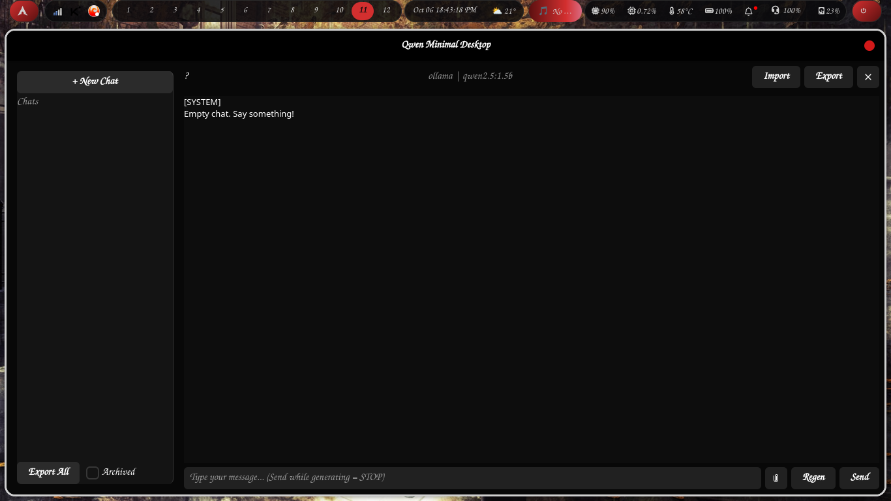

# Welcome to Qwen Minimal Desktop

A single-file, zero-dependency GTK4 chat client for Qwen and Kimi. Built specifically to run efficiently on older hardware without melting your CPU or spinning up fans.

## Why Qwen Minimal?

* **Single File Architecture**: The entire application is one plain-text Python script. No compiled binaries, no obfuscation, no `pip install` bloat.
* **Multi-Backend Support**: Seamlessly switch between local Ollama, Qwen Cloud (DashScope), and Kimi (Moonshot).
* **Smart Import/Export**: Automatically watches `~/Downloads` for Qwen web/Kimi exports and imports them with proper titles.
* **Thermal Awareness**: Built-in thread limiting to keep older CPUs cool during local inference.

Head over to the [Installation Guide](installation.md) to get up and running in seconds via the AUR!
